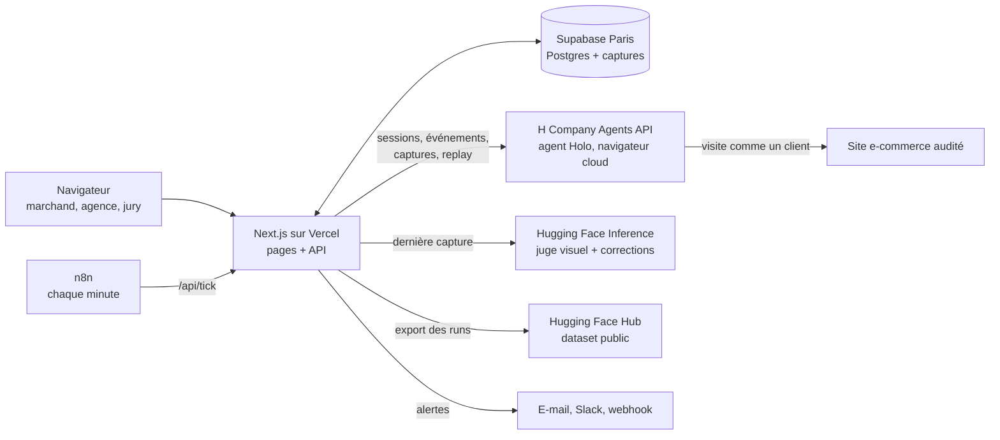

# AgentProof

**On envoie un client mystère IA sur ton site e-commerce.**

Un agent IA computer-use (Holo, de H Company) essaie d'acheter sur ton site comme un vrai client : il cherche, filtre, choisit une variante (taille, couleur…) et va jusqu'à la première page du checkout, sans payer. Tu reçois un score, la capture du moment exact où l'agent bloque, le replay de chaque session, la comparaison avec un concurrent et un plan de corrections.

| | |
|---|---|
| **Prototype en ligne** | https://agentproof-iota-tawny.vercel.app |
| Classement public (sans compte) | https://agentproof-iota-tawny.vercel.app/classement |
| Méthode | https://agentproof-iota-tawny.vercel.app/methode |
| Dataset des runs | https://huggingface.co/datasets/georgesdoxuan/agentproof-runs |
| **Fiche projet complète** (FR + résumé EN) | [docs/fiche-projet.md](docs/fiche-projet.md) |
| Guide d'utilisation | [docs/guide-utilisation.md](docs/guide-utilisation.md) |

Hackathon H Company × Hugging Face 2026 (Eugenia, 16–20 nov), track Creative Entrepreneur · Équipe 6, cinq personnes : CEO, CPO / CTO, CAIO, CAO, CDO.
Contexte complet : [CONTEXT.md](CONTEXT.md) · Plan d'action : [PLAN.md](PLAN.md)

## Comment tester

**Sans compte (1 minute)**

1. Ouvrir le [classement](https://agentproof-iota-tawny.vercel.app/classement) et cliquer sur un site : score, blocages, capture du blocage, comparaison.
2. Dans une mission, cliquer « Voir le replay » : chaque étape de l'agent avec l'écran, l'action, le point cliqué et son raisonnement.
3. Lire la [méthode](https://agentproof-iota-tawny.vercel.app/methode) : missions, juge visuel, score.

**Avec l'espace de démonstration du jury (10 minutes)**

> **Accès : [agentproof-iota-tawny.vercel.app/demo](https://agentproof-iota-tawny.vercel.app/demo)**, bouton « Entrer dans la démo ». Aucun e-mail ni mot de passe : chaque clic ouvre un compte juge dans l'équipe « Démo jury ».
> Cette équipe est séparée de l'espace de travail d'AgentProof : elle contient une copie de tous nos rapports, et rien de ce que fait le jury n'atteint nos audits. Chaque juge a 2 audits et 1 test de paiement réel (carte de démo à solde nul : l'agent va jusqu'à la banque, qui refuse) ; il peut ajouter un compte de test. Membres, automatisations et corbeille y sont fermés.

1. Ouvrir un rapport dans Rapports : par exemple waterdrop.fr (5 missions sur 5, test de paiement jusqu'au 3D Secure), nike.com (arrêté par l'anti-bot), promod.fr (agent précis).
2. Dans une mission, « Voir le replay » ; puis la page Corrections, qui liste ce qu'il faut réparer site par site.
3. « Lancer un audit » sur la boutique de son choix, ordinateur, avec ou sans test de paiement réel : le rapport se met à jour tout seul en 4 à 8 minutes hors file d'attente (missions en cours, puis score, blocages, captures, replays et plan de corrections).

## Problème

Les agents IA commencent à faire les courses à notre place. Sur beaucoup de sites, l'agent bloque (bandeau cookies, pop-up, sélecteur de taille, captcha, compte obligatoire), abandonne et achète ailleurs, sans que le marchand le voie. 44 % des Français utilisent déjà l'IA pour préparer un achat (OpinionWay pour La Retail Tech, novembre 2026, 1 045 répondants). Les outils existants lisent le code du site. Personne ne teste en vrai.

## Solution

1. **Missions** : parcours d'achat réalistes (recherche, menu, filtre prix, variante, promo, panier…), jusqu'à la première page du checkout.
2. **Score** : part des missions où l'agent atteint le checkout.
3. **Preuves** : dernière capture de l'agent + replay étape par étape (écran, action, point cliqué, raisonnement).
4. **Juge visuel à l'aveugle** : un modèle de vision Hugging Face regarde la dernière capture et la mission, sans connaître l'avis de l'agent. Si le juge ne répond pas, le run est « non vérifié » et sort du score.
5. **Corrections** : blocages classés par impact, plan de corrections écrit par un LLM, page Corrections et « Prouver la correction » qui rejoue les missions bloquées.

Autour de l'audit : classement public, test de paiement réel facultatif avec garde-fous, automations (veille des pages, alertes, audit mensuel), équipes avec rôles, marque blanche. Public visé : tout e-commerce de produits physiques, à commencer par la mode française (benchmark de 10 marques). Détails : [fiche projet](docs/fiche-projet.md).

## Stack

| Brique | Outil |
|---|---|
| App (front + API) | Next.js 16, React 19, Tailwind 4, sur **Vercel** (fonctions à Paris) |
| Base, captures | **Supabase** Postgres + Storage (Paris) |
| Agent | **H Company Agents API** : agent `agentproof-shopper` (`holo4-35b-a3b` rapide, `holo4-27b` précis), navigateur cloud, coffre-fort H pour les comptes de test |
| Juge visuel + plan de corrections | **Hugging Face** Inference Providers (`Qwen/Qwen3.5-9B`) |
| Dataset ouvert | **Hugging Face Hub** (`georgesdoxuan/agentproof-runs`) |
| Ordonnanceur, e-mails, notifications | **n8n** (appel de `/api/tick` chaque minute) |

## Architecture



| Brique | Fichier |
|---|---|
| Config de l'agent H (consignes, règles, schéma de réponse) | [agent/agent.json](agent/agent.json) |
| Moteur : création d'audit, tick, juge, corrections, replay | [web/lib/engine.ts](web/lib/engine.ts) |
| Routes API (audits, tick, hooks) | [web/app/api](web/app/api) |
| Replay étape par étape | [web/app/replay/[run]/page.tsx](web/app/replay/[run]/page.tsx) |
| Pages publiques et espace d'équipe | [web/app](web/app) |
| Schéma de la base (migrations) | [supabase](supabase) |
| Export du dataset Hugging Face | [scripts/export-hf.sh](scripts/export-hf.sh) |

### Pourquoi un tick et pas des webhooks

Les clés H du plan Free sont limitées à 3 sessions en parallèle. La page des clés annonçait aussi 5 requêtes par minute, mais l'API répond `x-ratelimit-limit: 40000` et aucune rafale n'a reçu de 429 (mesuré le 18 nov). Un seul point d'entrée (`/api/tick`, appelé chaque minute par n8n) parle à H : pendant 45 s, il fait une passe toutes les 10 s, récupère les sessions finies (1 requête pour les événements, 1 pour la capture, le juge de chaque session en parallèle) et remplit aussitôt les places libres (1 requête par lancement). Un audit lance sa première passe dès sa création, sans attendre le cron. Une mission échouée est rejouée dès son échec, pendant que les autres tournent. Les replays sont créés à la demande (1 requête par run, une seule fois) : la trajectoire partagée et ses captures sont ensuite publiques, sans clé ni limite.

### En local

```bash
cd web && cp ../.env.example .env.local   # puis remplir les clés (jamais commitées)
npm install && npm run dev
curl localhost:3000/api/tick -H "x-tick-secret: $TICK_SECRET"   # fait avancer les audits
```

## Résultats (benchmark du 17 nov 2026)

10 sites mode français × 5 missions, agent `holo4-35b-a3b`, ordinateur. **36 missions réussies sur 52 (69 %)**, environ 90 s et 19 étapes par mission, **1,68 $ au total** (0,03 $ par mission en moyenne).

| Site | Réussies | Blocages relevés |
|---|---|---|
| Asphalte | 5/5 | — |
| Jules | 5/5 | — |
| Celio | 6/7 | compte obligatoire |
| Bonobo | 3/5 | sélecteur de taille, compte obligatoire |
| Sézane | 3/5 | autre |
| Balibaris | 3/5 | rupture de stock, autre |
| Le Slip Français | 3/5 | autre |
| Promod | 3/5 | bouton qui ne réagit pas, autre |
| Etam | 2/5 | compte obligatoire, autre |
| Kiabi | 0/5 | captcha / anti-bot, autre |

Détail mission par mission, captures et replays : classement en ligne et dataset Hugging Face.

## Benchmark mobile (18 nov 2026)

5 sites du classement × 5 missions, écran de téléphone (390×844), même agent. **13 missions réussies sur 23 comptées (57 %)**, contre 45 sur 47 (96 %) sur ordinateur pour les mêmes sites. Environ 105 s par mission, 1,43 $ au total.

| Site | Mobile | Ordinateur (classement) | Blocages relevés sur mobile |
|---|---|---|---|
| Jules | 5/5 | 9/9 | — |
| Asphalte | 3/4 | 10/10 | bouton qui ne réagit pas |
| Celio | 2/5 | 10/10 | compte obligatoire (3) |
| Promod | 2/5 | 7/9 | sélecteur de taille (2), bandeau cookies |
| Sézane | 1/4 | 9/9 | compte obligatoire (2), bouton qui ne réagit pas |

Les sites « prêts pour les agents » sur ordinateur bloquent bien plus sur mobile. À vérifier à la main : les blocages « compte obligatoire » de Celio et Sézane, qui ne sortent pas sur ordinateur.

## Test de paiement réel (facultatif)

Test à part de l'audit : l'agent prend le premier article disponible et **paie une seule fois** avec la carte de l'équipe, en 3 à 10 minutes. Un refus « fonds insuffisants » ou une demande de **3D Secure** prouve que le paiement a atteint la banque ; un agent ne valide pas le 3D Secure seul, donc la commande n'est pas confirmée et le rapport affiche « 100 % hors paiement ».

- **Garde-fous** : case de confirmation à chaque test, plafond de 150 € livraison comprise, une seule tentative, jamais sur un concurrent, jamais de faux numéro de carte.
- **Données** : carte chiffrée et jamais réaffichée ; numéro, date et cryptogramme masqués dans le texte du replay ; captures floutées dès la saisie de la carte, replay privé à l'équipe, captures effacées 4 h après le test.
- **Comptes de test** du marchand rangés dans un coffre-fort H Company : l'agent ne voit jamais le mot de passe.
- **Point ouvert** : stocker le cryptogramme, même chiffré, n'est pas conforme PCI DSS. Acceptable pour une carte virtuelle de test à 0 €, pas en production : coffre-fort de cartes (Stripe, VGS) ou cartes émises par nous (Stripe Issuing, Adyen, Swan) avec refus en temps réel.

## Fiabilité et sobriété

- **Accord juge / agent** : sur 140 runs vérifiés à l'aveugle (capture + URL de la page, jamais l'avis de l'agent), le juge donne le même verdict que l'agent dans 114 cas (81 %). Les écarts sont surtout des pages panier que l'agent croyait être le checkout.
- **Score honnête** : seuls les runs vérifiés comptent. Rupture de stock, mission impossible sur le catalogue (ex. un site de porte-clés) et agent à court d'étapes sont affichés à part, hors score. Un blocage anti-bot compte comme un échec depuis le 20 nov : il bloquerait aussi l'agent d'un vrai client.
- **Répétabilité** : 10 sites joués deux fois, même verdict pour 30 missions sur 37 comparables (81 %). Le classement public fait donc la moyenne des 2 derniers passages de chaque site.
- **Échec confirmé** : chaque mission ratée est rejouée une fois avant la clôture de l'audit ; le second essai fait foi (sauf anti-bot, rupture, compte obligatoire, mission impossible, qu'un nouvel essai ne changerait pas). Le premier essai reste visible dans le rapport, et le coût affiché inclut les deux.
- **Sobriété** : le moteur interroge le quota H et ne lance plus rien quand il reste moins de 10 M de tokens gratuits (`TOKEN_RESERVE`) ; un site bloqué par l'anti-bot n'use qu'une mission ; un site audité depuis moins de 7 jours renvoie au rapport existant.
- **Robustesse** : une requête liste l'état de toutes les sessions ; un run en erreur ne bloque plus la file ; chaque run est réservé avant lancement (pas de doublon) ; chaque audit n'est clôturé et notifié qu'une fois.
- **Formulaire protégé** : domaines publics uniquement, 6 audits par heure et par connexion, liste de domaines autorisés pour la démo (`ALLOWED_DOMAINS`), `FORM_MISSIONS=3` le jour de la démo.

## Automations (surveillance quotidienne)

Espace › Automations : l'équipe colle une ou plusieurs URL. Une fois par jour, le tick lit chaque page via Jina Reader (rendu dans un vrai navigateur, passe les 403 anti-bot) et en garde la structure, sans IA : titre, domaines des scripts tiers, iframes, formulaires, champs, libellés des boutons. Prix, produits et chiffres sont ignorés. Si la liste diffère de la veille, l'équipe est prévenue (section + e-mail au créateur) et, en mode « Prévenir et auditer », un audit repart tout seul. Lecture stable vérifiée : 3 lectures identiques de suite sur jules.com, celio.com, allbirds.com. Une page anti-bot (moins de 5 éléments) n'est jamais prise comme référence. Tables `automations` et `automation_checks`. `JINA_API_KEY` facultative (gratuit : 20 pages par minute).

Depuis le 19 novembre :
- **Fréquence par page** : toutes les heures, 6 h, une fois par jour (défaut) ou par semaine (`automations.interval_hours`). Une vérification par tick tant qu'il reste 40 s.
- **Contrôle statique suivi** : chaque vérification ajoute à la signature les lignes du contrôle statique (robots.txt, anti-bot, schema.org, UCP, ACP, WebMCP, llms.txt). Un robots.txt qui se ferme aux agents ou un profil UCP qui disparaît compte comme un changement. Les anciennes références adoptent ces lignes sans alerte.
- **Webhook d'équipe** (`teams.webhook_url`) : chaque changement et chaque baisse de score part aussi sur Slack (`{text}`), Discord (`{content}`) ou une URL https quelconque (JSON `{source, event, domain, text, link}`).
- **Seuil de baisse de score** par équipe : 5, 10 (défaut) ou 20 points (`teams.score_drop`).
- **Mise en ligne** : `POST /api/hooks/<teams.hook_token>` (Vercel `deployment.succeeded`, Shopify `themes/publish`, GitHub `deployment_status`, ou `curl`) fait vérifier toutes les pages de l'équipe dans la minute. Un seul déclenchement par 2 minutes.
- **Budget** : au plus un audit automatique par page et par 24 h ; les missions des audits automatiques (`runs.priority = 1`) partent après celles lancées à la main. `AUTOMATIONS_PAUSED=1` (variable Vercel) suspend veille et audits mensuels, par exemple pendant une démo.

## Pour les marchands et les agences

- **Suivi mensuel** (offre à 149 €/mois) : dans Espace › Automations, « Audit tous les 30 jours » relance un audit complet chaque mois. À la clôture de chaque audit d'équipe, si le score baisse de 10 points ou plus par rapport à l'audit précédent (même site, appareil et modèle), le rapport l'affiche et un e-mail part.
- **Contrôle statique gratuit** : à chaque nouvel audit, le tick lit le site sans agent ni crédit H : robots.txt (GPTBot, ChatGPT-User, ClaudeBot, PerplexityBot…), accès sans navigateur, scripts anti-bot et captcha connus, schema.org (dont SearchAction), catalogue Shopify `products.json` et fiche Product, `llms.txt`, plateforme, protocoles d'achat pour agents (profil UCP `/.well-known/ucp`, manifeste ACP, outils WebMCP), frais de port et politique de retour en schema.org. Le rapport place les deux voies côte à côte : par l'écran (score de l'agent) et par protocole. Affiché à côté des résultats de l'agent, hors score.
- **Badge « Agent-ready »** : `/badge/<id de l'audit>.svg`, avec le code HTML à copier depuis le rapport. Par audit et non par domaine : un rapport d'équipe reste privé tant que l'équipe ne partage pas le lien.
- **Rapport PDF** : bouton « Télécharger en PDF » (impression du navigateur), toujours en clair, sans navigation ni boutons.
- **Modèle de l'agent** : audit rapide (`holo4-35b-a3b`) ou précis (`holo4-27b`), ou les deux côte à côte (réussite, durée, coût par mission).
- **Marque blanche** : Équipe › Marque blanche, le nom et le logo de l'agence remplacent AgentProof sur les rapports de l'équipe (page et PDF). Les pages de replay restent aux couleurs d'AgentProof.
- **Replay du premier essai** : quand une mission a été rejouée, les deux tentatives restent visibles.

## Limites et roadmap

- Une mission échoue parfois à cause de l'agent et pas du site : le juge visuel limite les faux succès, pas les faux échecs.
- Navigateur cloud depuis une IP de datacenter : certains sites anti-bot bloquent, comme ils bloqueraient un vrai agent (compté comme un échec).
- Mobile = taille d'écran mobile, sans user-agent mobile.
- Un seul agent mesuré (Holo). Paiement en ligne pas encore ouvert : rien n'est facturé pendant l'essai.
- À venir : cartes de test émises par nous et coffre-fort de cartes, plusieurs agents (ChatGPT agent…), vrai user-agent mobile, comptes de test et préproduction fournis par le marchand, d'autres secteurs que la mode.

## Retours sur l'Agent API de H

| Date | Ce qui a marché / cassé / surpris |
|---|---|
| 17 nov | Création d'agent par API et `answer_format` : simple, la réponse structurée arrive bien typée. |
| 17 nov | Les événements d'une session contiennent tout (réponse, tokens, coût en $, URL et capture de chaque étape) : un seul appel suffit pour finaliser un run. |
| 17 nov | La console affiche « services indisponibles » alors que l'API répond normalement. |
| 17 nov | La limite Free de 5 requêtes/min par clé impose un ordonnanceur ; pas documentée dans « Plans and limits », seulement sur la page des clés. |
| 17 nov | La ressource `screenshots/step-N.png` de la doc renvoie 404 ; l'URL de capture se trouve dans les événements d'observation. |
| 18 nov | Sur Kiabi, Holo envoie en boucle `scroll_web` avec `scroll_element` sous forme de chaîne JSON au lieu d'un objet : jusqu'à 19 appels rejetés (`validation_errors` dans les `policy_event`) sur 30 étapes, et la mission échoue. Le moteur classe ces échecs en `agent_tool_error`, hors score. |
