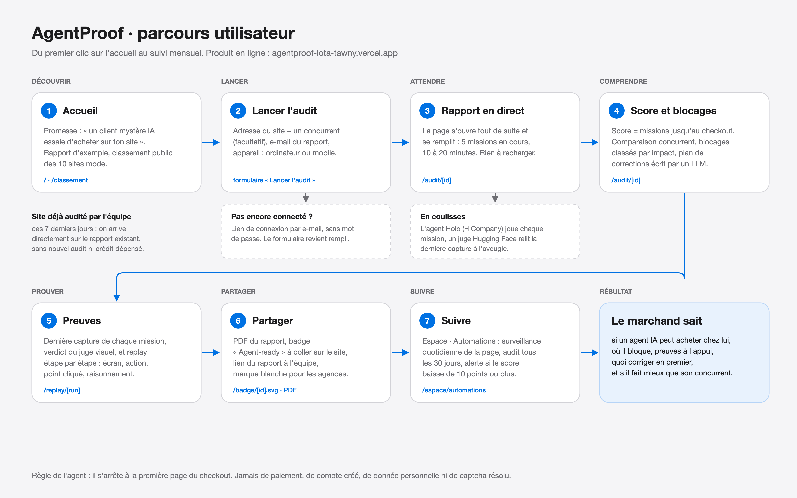
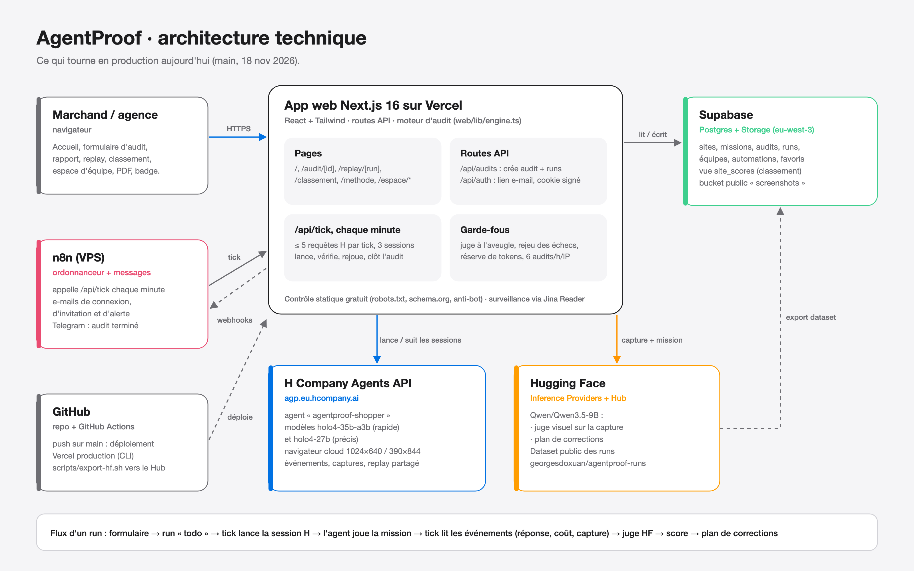

# Checkpoint 2 · mercredi 18 novembre 2026

| # | Livrable | Fichier |
|---|---|---|
| 01 | Parcours utilisateur | [parcours-utilisateur.png](parcours-utilisateur.png) · [SVG](parcours-utilisateur.svg) |
| 02 | Architecture technique | [architecture.png](architecture.png) · [SVG](architecture.svg) |
| 03 | Mini pitch (Loom 2 min) : texte, plus la version 6 min du pitch final | [pitch.md](pitch.md) |
| 04 | Roadmap jusqu'à vendredi | [roadmap.md](roadmap.md) |

Les schémas sont générés par `python3 docs/checkpoint-2/build.py` (SVG, puis PNG 2x via Chrome headless).

