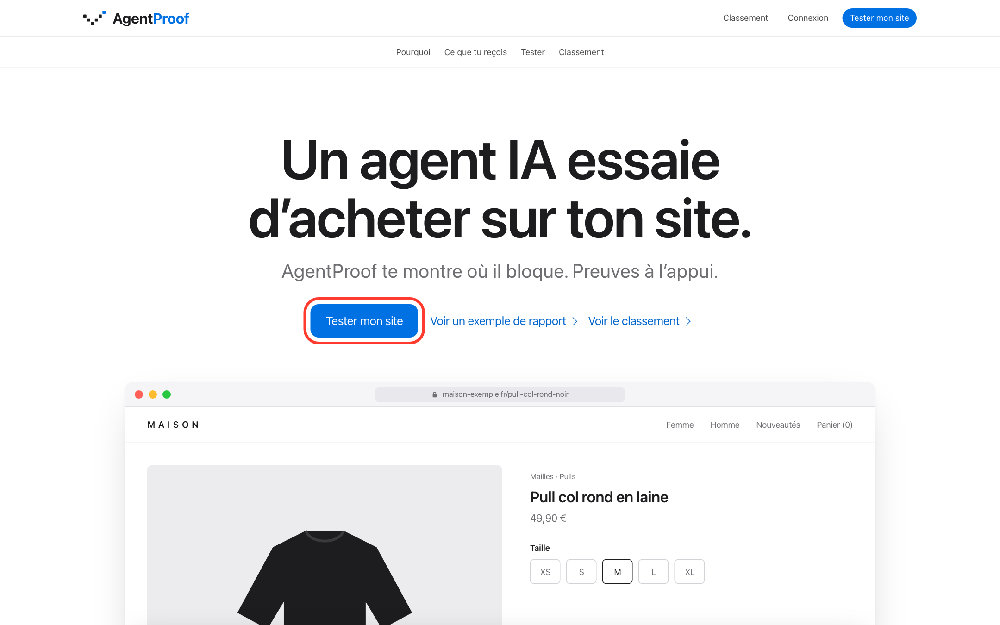
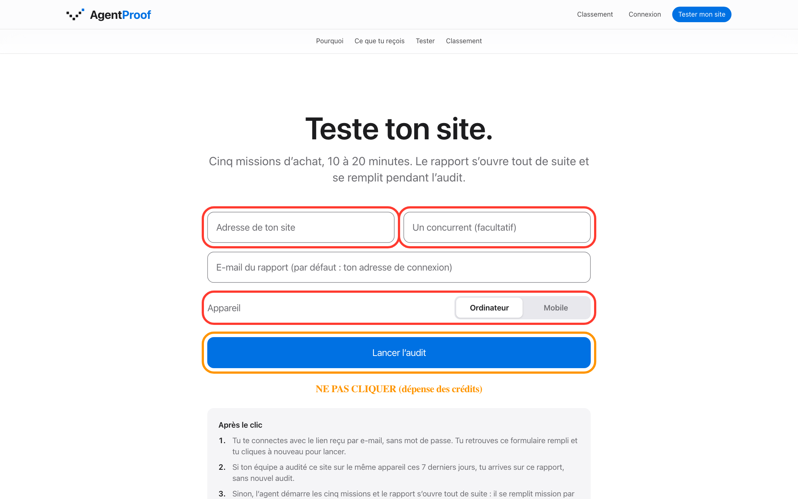
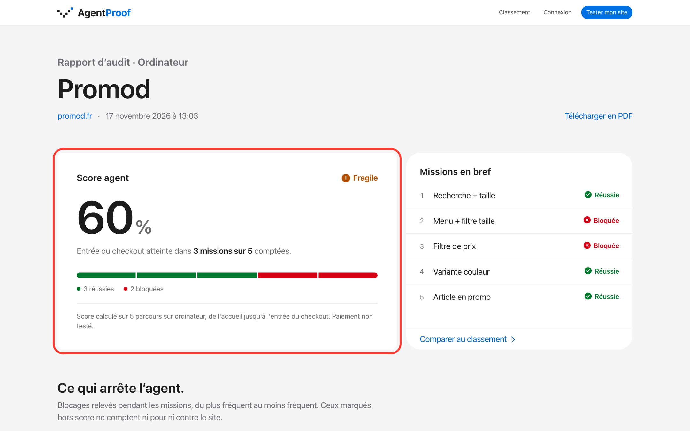
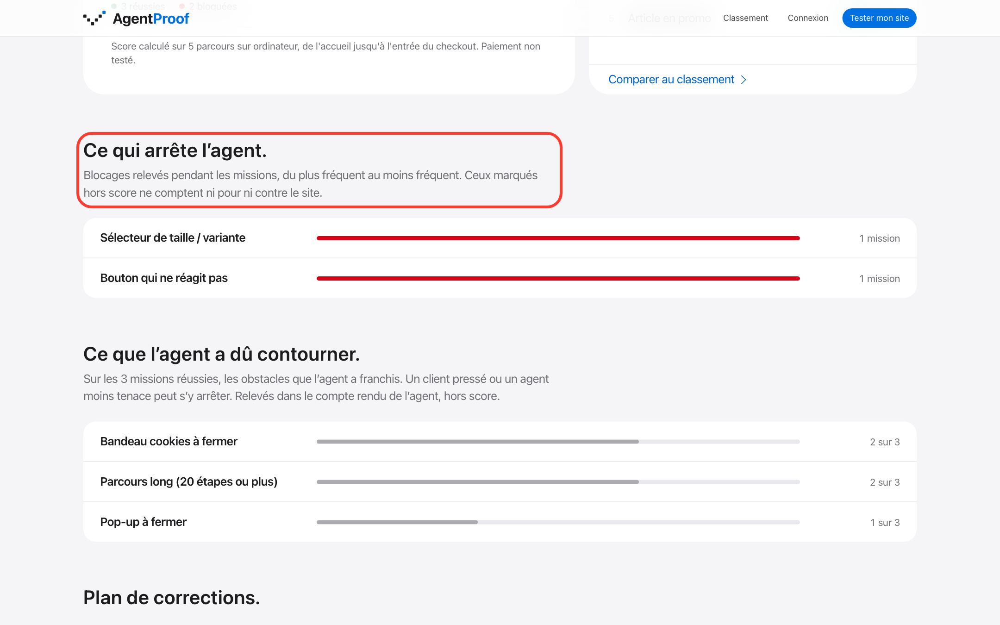
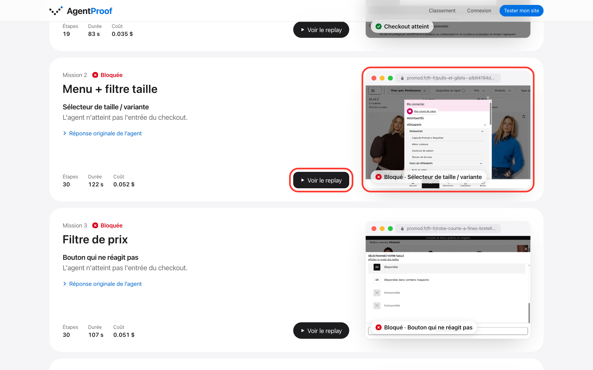
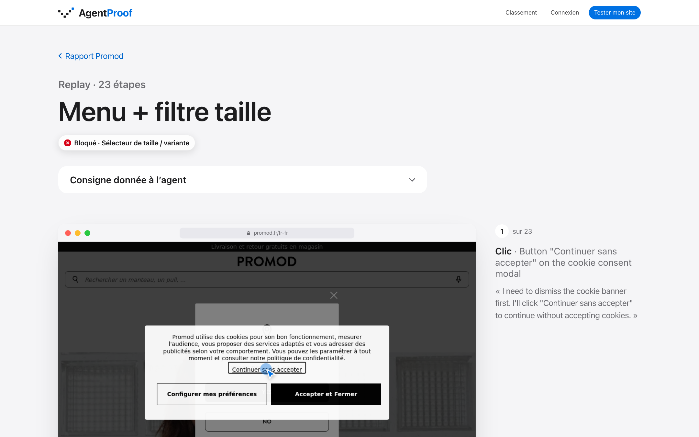
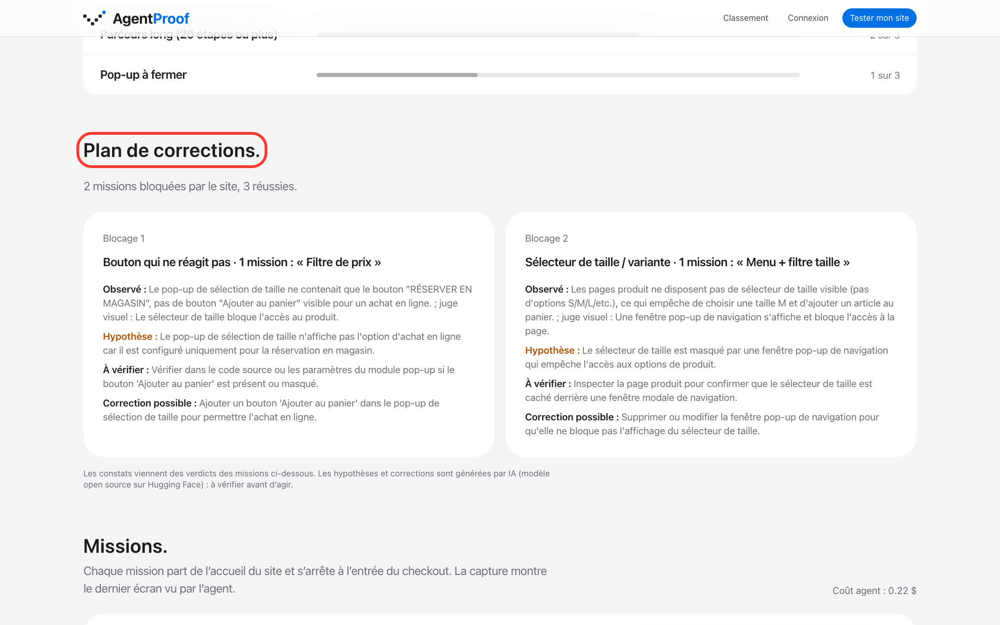
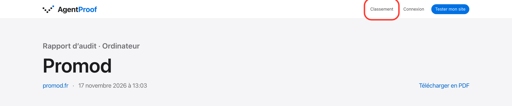
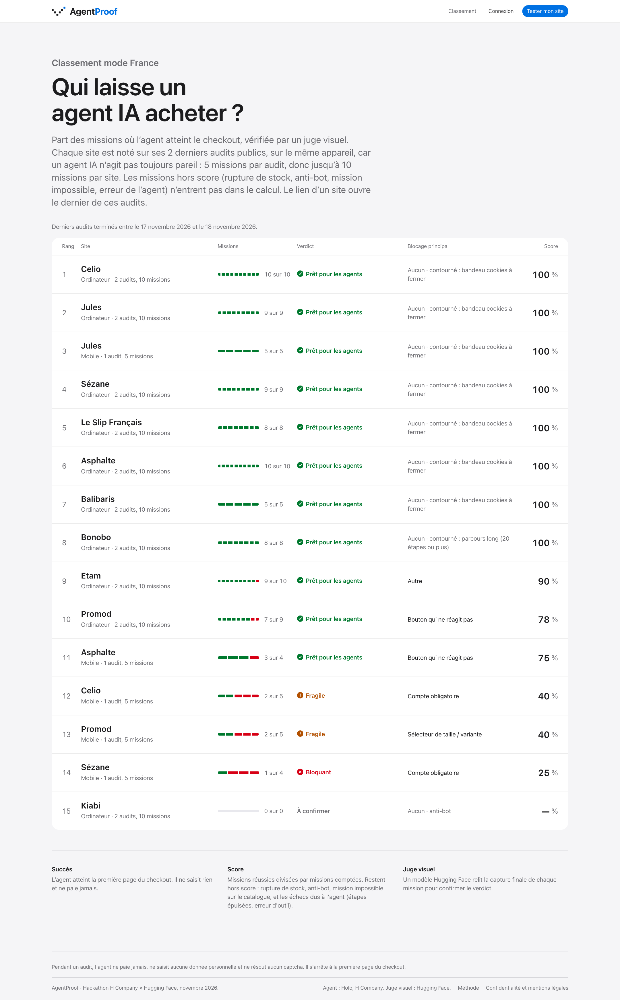

# Loom 2 minutes · guide pas à pas

Mini pitch du checkpoint 2 (mercredi 18 nov, avant 17 h) : problème, solution, avancement.
Captures prises sur le site en ligne le 18 nov à 15 h 35 (dernière version de main). Ce guide est fait pour quelqu'un qui n'a jamais utilisé AgentProof. Chaque étape dit **quoi ouvrir**, **où cliquer** (entouré en rouge sur la capture) et **quoi dire**.

## En 30 secondes : c'est quoi AgentProof ?

Un site web. On donne l'adresse d'une boutique en ligne. Un robot (un « agent IA ») essaie d'y acheter un vêtement comme un vrai client : il cherche, choisit une taille, met au panier et va jusqu'à la page de paiement, **sans jamais payer**. AgentProof donne ensuite une note (le « score »), montre où le robot a bloqué et propose des corrections.

Tu n'as **rien à lancer** pendant le Loom : on montre un rapport déjà terminé (la boutique Promod) et le classement.

## Avant d'enregistrer (2 minutes de préparation)

1. Ouvre **https://agentproof-iota-tawny.vercel.app** dans Chrome. Pas besoin de se connecter.
2. Ouvre un 2e onglet sur le rapport Promod : sur l'accueil, clique **« Voir un exemple de rapport »** (juste à droite du bouton bleu). Ou colle directement : https://agentproof-iota-tawny.vercel.app/audit/8c843d3f-3d95-4834-aace-21880a85f499
3. Reviens sur le 1er onglet (l'accueil), tout en haut de la page.
4. Lance l'enregistrement Loom en mode « écran + caméra », sur l'onglet Chrome.

---

## Étape 1 · 0:00 – 0:20 · Le problème

**Onglet :** l'accueil. **Clic :** aucun, reste en haut de la page.

> « Demain, ce ne sera plus toujours un humain qui achète sur votre site. Ce sera son agent IA : "trouve-moi un pull noir en M à moins de 60 euros et commande-le". Or 63 % des responsables e-commerce disent qu'un agent ne peut pas finaliser un achat sur leur site. Quand l'agent bloque, il part chez le concurrent sans laisser de trace. Le marchand ne le voit jamais. »

## Étape 2 · 0:20 – 0:45 · La solution

**Clic :** le bouton bleu **« Tester mon site »** (entouré en rouge ci-dessus). La page descend toute seule jusqu'au formulaire « Teste ton site. ».

**Montre avec la souris** (sans rien taper) : « Adresse de ton site », « Un concurrent (facultatif) », puis le choix **Ordinateur / Mobile**.

⚠️ **Ne clique pas sur « Lancer l'audit »** (entouré en orange) : ça lance un vrai robot et dépense des crédits.

> « AgentProof, c'est un client mystère IA. Les outils actuels lisent le code du site. Nous, on envoie un vrai agent computer-use de H Company, Holo, qui regarde l'écran et clique comme un client. Vous donnez votre site et un concurrent. L'agent joue cinq missions d'achat : recherche, filtre de prix, taille, promo, panier. Il va jusqu'à la première page du checkout et ne paie jamais. »

## Étape 3 · 0:45 – 1:00 · Démo : le score

**Onglet :** passe sur le 2e onglet, le rapport **Promod**. **Clic :** aucun.

**Montre :** le grand chiffre **60 %** (le score) dans le cadre « Score agent », puis à droite la liste **« Missions en bref »** : 3 missions « Réussie » en vert, 2 « Bloquée » en rouge.

> « Voici le rapport. Un score : la part des missions menées jusqu'au checkout. Ici, 3 missions sur 5. »

## Étape 4 · 1:00 – 1:05 · Démo : les blocages

**Clic :** aucun. **Fais défiler** un peu vers le bas jusqu'au titre **« Ce qui arrête l'agent. »**

> « Les blocages, classés du plus fréquent au moins fréquent. »

## Étape 5 · 1:05 – 1:15 · Démo : la preuve et le replay

**Fais défiler** jusqu'à la mission **« Menu + filtre taille »** (marquée « Bloquée » en rouge). On voit à droite la capture du dernier écran vu par le robot.

**Clic :** le bouton noir **« ▸ Voir le replay »** de cette mission (entouré en rouge).

La page du replay s'ouvre. **Fais défiler** doucement : chaque étape montre l'écran, l'action du robot (point bleu = où il a cliqué) et son raisonnement à droite.

> « Pour chaque échec, la capture du moment exact où l'agent bloque. Et le replay étape par étape : ce que l'agent voyait, où il a cliqué, pourquoi. »

## Étape 6 · 1:15 – 1:25 · Démo : le plan de corrections

**Clic :** **« ‹ Rapport Promod »** en haut à gauche du replay, pour revenir au rapport. **Fais défiler** jusqu'au titre **« Plan de corrections. »**

> « Un juge visuel Hugging Face relit la dernière capture à l'aveugle, pour éviter les faux succès. Ensuite, un LLM écrit le plan de corrections : ce qu'on a observé, et quoi corriger. »

## Étape 7 · 1:25 – 1:50 · L'avancement : le classement

**Clic :** **« Classement »** dans la barre tout en haut de la page (en gris, à gauche de « Connexion »).

**Montre :** en haut, les sites testés sur **Ordinateur**, presque tous à 100 %. Puis descends : les lignes **Mobile** sont bien plus bas (Celio 40 %, Promod 40 %, Sézane 25 %). Tout en bas, Kiabi, qui bloque l'agent avec son anti-bot.

> « Le produit est en ligne et on a audité 10 marques de mode françaises. Une mission dure environ 90 secondes et coûte 3 centimes. Et voici notre résultat du jour : sur ordinateur, l'agent réussit 96 % des missions sur ces sites. Sur téléphone, sur les mêmes sites, seulement 57 %. Des sites "prêts pour les agents" sur ordinateur bloquent sur mobile, et leurs marchands ne le savent pas. »

## Étape 8 · 1:50 – 2:00 · La suite

**Clic :** aucun, reste sur le classement.

> « D'ici vendredi : vérifier à la main les blocages mobiles, mesurer l'accord du juge avec un humain, rendre les audits plus rapides, et faire la démo live devant vous. Le classement est gratuit, l'audit coûte 490 euros, le suivi mensuel 149 euros. Merci ! »

Arrête l'enregistrement.

---

## Si quelque chose coince

- **Une page met du temps à charger :** continue à parler et passe à l'étape suivante.
- **Le rapport Promod affiche 60 % et le classement 78 % :** c'est normal. Le classement fait la moyenne des 2 derniers audits du site, le rapport montre un seul audit.
- **On te demande de te connecter :** tu n'en as pas besoin. Toutes les pages du guide sont publiques.
- **Tu as cliqué « Lancer l'audit » par erreur :** une page de connexion s'ouvre, ferme-la. Rien n'est lancé sans connexion.
