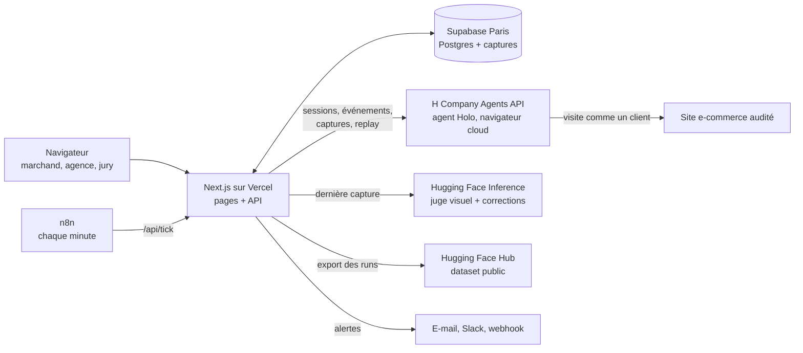

# AgentProof · fiche projet

> **On envoie un client mystère IA sur ton site e-commerce.**
> Les autres outils lisent le plan du magasin. Nous, on envoie un client.

Hackathon H Company × Hugging Face (Eugenia, 16–20 nov 2026) · track Creative Entrepreneur · Équipe 6.

| | |
|---|---|
| Prototype en ligne | https://agentproof-iota-tawny.vercel.app |
| Classement public (sans compte) | https://agentproof-iota-tawny.vercel.app/classement |
| Méthode (missions, juge, score) | https://agentproof-iota-tawny.vercel.app/methode |
| Repo | https://github.com/georgesdoxuan/AgentProof |
| Dataset des runs (Hugging Face) | https://huggingface.co/datasets/georgesdoxuan/agentproof-runs |
| Accès démo pour le jury | voir [Comment tester](#8-comment-tester) |

---

## 1. Problème

Les agents IA commencent à faire les courses à notre place : « trouve-moi un pull noir en M à moins de 60 € et commande-le ». Sur beaucoup de sites, l'agent bloque : bandeau cookies qui masque « Ajouter au panier », pop-up, sélecteur de taille qu'il ne sait pas cliquer, captcha, compte obligatoire. Il abandonne, achète ailleurs, et le marchand ne le voit jamais.

- **63 %** des responsables e-commerce disent que leur tunnel d'achat ne peut pas être finalisé par un agent IA, et 61 % n'ont pas de budget pour ça en 2026 (Blend Commerce, 59 répondants, juillet–août 2026).
- Les outils existants (dont le score gratuit de Shopify) **lisent le code** du site : « en théorie, un agent devrait pouvoir acheter ». Personne ne teste en vrai.

## 2. Solution

AgentProof envoie un **vrai agent computer-use** (Holo, de H Company) qui regarde l'écran et clique comme un client. Ce qu'on mesure, c'est justement l'interface : un script ou une API ne voit pas qu'un bandeau cache le bouton, un agent qui regarde l'écran tombe dans le piège.

En cinq étapes :

1. **Missions** : des parcours d'achat réalistes (recherche, menu, filtre de prix, variante, promo, deux articles, quantité, frais de port, faute de frappe…), jusqu'à la **première page du checkout**.
2. **Score** : la part des missions menées jusqu'au checkout.
3. **Preuves** : la capture du moment exact où l'agent bloque, et le replay étape par étape (écran, action, point cliqué, raisonnement).
4. **Comparaison** : les mêmes missions chez un concurrent.
5. **Corrections** : les blocages classés par impact et un plan de corrections écrit par un LLM, puis « Prouver la correction » qui rejoue seulement les missions bloquées.

## 3. Public cible

- **Marchands e-commerce de produits physiques** : responsable e-commerce ou conversion d'une marque de 5 à 50 M€ de CA (Shopify, PrestaShop, Salesforce Commerce…). Il perd des ventes « agent » sans le voir et veut un score, des preuves et une liste de corrections.
- **Agences e-commerce et SEO** : elles vendent déjà des audits SEO et UX, elles revendent « l'audit agent-ready » en marque blanche.
- **Point d'entrée : la mode française.** Le benchmark public porte sur 10 marques mode ; les missions par défaut valent pour tout site qui vend des produits physiques.

## 4. Comment ça marche

| Brique | Ce qu'elle fait |
|---|---|
| **Agent H Holo** | Agent catalogue `agentproof-shopper` sur l'Agents API de H (modèle rapide `holo4-35b-a3b` ou précis `holo4-27b`), navigateur cloud, écran ordinateur 1024×640 ou mobile 390×844. Réponse structurée : checkout atteint, blocage (liste fermée), détail. |
| **Règles non négociables** | Ajoutées à chaque consigne : ne jamais payer pendant un audit, aucun compte créé, aucune donnée personnelle, jamais de captcha résolu, volume faible. |
| **Juge visuel à l'aveugle** | Un modèle de vision Hugging Face (`Qwen/Qwen3.5-9B`, Inference Providers) relit la dernière capture et l'URL, sans connaître l'avis de l'agent. Succès = l'agent dit avoir atteint le checkout **et** le juge le confirme. Juge muet = run « non vérifié », hors score. |
| **Score honnête** | Runs réussis / runs comptés. Hors score : non vérifiés, rupture de stock, anti-bot, mission impossible sur le catalogue, agent à court d'étapes, appels d'outil mal formés. Chaque mission ratée est rejouée une fois ; le second essai fait foi. |
| **Test de paiement réel (facultatif)** | Test à part : l'agent prend le premier article disponible et paie **une seule fois** avec la carte de l'équipe. Un refus « fonds insuffisants » ou une demande de **3D Secure** prouve que le paiement a atteint la banque. Garde-fous : case de confirmation à chaque test, plafond de 150 € livraison comprise, une seule tentative, jamais sur un concurrent, replay privé, carte masquée dans le texte et captures floutées dès la saisie, captures effacées après 4 h. Comptes de test du marchand dans un coffre-fort H : l'agent ne voit jamais le mot de passe. |
| **Classement public** | Sans compte : sites comparés sur la moyenne des 2 derniers audits (même appareil), car un agent n'agit pas toujours pareil. |
| **Corrections** | Page Espace › Corrections : toutes les corrections à faire, filtrables, puis « Prouver la correction ». |
| **Automations** | Pages relues chaque heure, 6 h, jour ou semaine (structure de la page et contrôle statique, sans IA, prix ignorés). Changement ou baisse de score : alerte e-mail, Slack ou webhook, audit relancé si demandé. Audit mensuel automatique, hook « après mise en ligne » (Vercel, Shopify, GitHub). Plafond de crédits par site. |
| **Contrôle statique gratuit** | Sans agent : robots.txt (GPTBot, ClaudeBot…), anti-bot connus, schema.org, `llms.txt`, protocoles d'achat pour agents (UCP, ACP, WebMCP). Affiché à côté du score, hors score. |
| **Équipes et rôles** | Propriétaire, admin, éditeur, lecteur. Plusieurs équipes par compte, marque blanche pour les agences, rapport PDF, badge « Agent-ready ». |

## 5. Résultats mesurés

| Mesure | Valeur |
|---|---|
| Benchmark ordinateur (17 nov) | 10 sites mode × 5 missions : **36 / 52 missions réussies (69 %)** |
| Benchmark mobile (18 nov) | 5 sites : **13 / 23 (57 %)**, contre 45 / 47 (96 %) sur ordinateur pour les mêmes sites |
| Durée et coût par mission | ~90 s, ~19 étapes, **0,03 $** (1,68 $ pour tout le benchmark ordinateur) |
| Accord juge / agent | 114 / 140 runs vérifiés (81 %) |
| Répétabilité | même verdict pour 30 / 37 missions rejouées (81 %) |
| Accord juge / humain | **À COMPLÉTER** (vérification manuelle en cours) |

Un audit complet de 5 missions coûte moins de 50 centimes de calcul, rejeux compris.

## 6. Stack

| Brique | Outil |
|---|---|
| App (front + API) | Next.js 16, React 19, Tailwind 4, déployé sur **Vercel** (fonctions à Paris, `cdg1`) |
| Base, auth des équipes, captures | **Supabase** Postgres + Storage (Paris, eu-west-3) |
| Agent | **H Company Agents API** (endpoint EU), agent `agentproof-shopper`, coffre-fort H pour les comptes de test |
| Juge visuel et plan de corrections | **Hugging Face** Inference Providers, `Qwen/Qwen3.5-9B` |
| Dataset ouvert | **Hugging Face Hub**, `georgesdoxuan/agentproof-runs` |
| Ordonnanceur et notifications | **n8n** : appelle `/api/tick` chaque minute, e-mails de connexion et d'invitation, Telegram en fin d'audit |
| Lecture des pages (automations) | Jina Reader |

## 7. Architecture

Flux d'un audit :

1. `POST /api/audits` crée l'audit et ses runs `todo` (missions × appareils, plus le concurrent).
2. `/api/tick` (n8n chaque minute, et dès la création de l'audit) : pendant 45 s, une passe toutes les 10 s récupère les sessions H finies (réponse, coût, capture), fait juger la capture par Hugging Face, puis lance les runs en attente dans les places libres (3 sessions en parallèle sur le plan Free).
3. À la fin : rejeu des missions ratées, score, plan de corrections, e-mail et alertes.
4. Le rapport se met à jour tout seul ; « Voir le replay » crée la trajectoire partagée H à la demande.

Pourquoi un ordonnanceur plutôt que des webhooks : les clés Free sont limitées à 3 sessions en parallèle, et un seul point d'entrée qui parle à H garde la file d'attente, les priorités (audits manuels avant automatiques) et la réserve de tokens sous contrôle.

## 8. Comment tester

**Sans compte (1 minute)**

1. Ouvrir le [classement](https://agentproof-iota-tawny.vercel.app/classement) et cliquer sur un site : rapport, captures du blocage, comparaison.
2. Dans une mission, cliquer « Voir le replay » : chaque étape de l'agent, avec l'écran, l'action et son raisonnement.
3. Lire la [méthode](https://agentproof-iota-tawny.vercel.app/methode) : missions, juge, score.

**Avec l'espace de démonstration du jury (10 minutes)**

> **Accès : [agentproof-iota-tawny.vercel.app/demo](https://agentproof-iota-tawny.vercel.app/demo)**, bouton « Entrer dans la démo ». Aucun e-mail ni mot de passe : chaque clic ouvre un compte juge dans l'équipe « Démo jury ».
> Cette équipe est séparée de l'espace de travail d'AgentProof : elle contient des copies de rapports réels, et rien de ce que fait le jury n'atteint nos audits. Carte de paiement, comptes de test, membres, automatisations et corbeille y sont désactivés ; 2 audits par juge.

1. Ouvrir un rapport d'exemple dans Rapports : waterdrop.fr (5 missions sur 5), nike.com (arrêté par l'anti-bot), promod.fr (agent précis).
2. Dans une mission, « Voir le replay » ; puis la page Corrections, qui liste ce qu'il faut réparer site par site.
3. « Lancer un audit » sur la boutique de son choix, ordinateur : le rapport se met à jour tout seul en 5 à 10 minutes (missions en cours, puis score, blocages, captures, replays et plan de corrections).

## 9. Limites honnêtes

- **Navigateur cloud depuis une IP de datacenter** : certains anti-bots bloquent l'agent (Kiabi 0 / 5), comme ils bloqueraient un vrai agent client. Ces missions sortent du score.
- **Le juge limite les faux succès, pas tous les faux échecs** : une mission peut échouer à cause de l'agent et non du site. L'accord juge / humain est en cours de mesure ; les écarts juge / agent viennent surtout de pages panier prises pour le checkout.
- **Mobile simulé** : taille d'écran de téléphone, sans user-agent mobile.
- **Un agent mesuré** : Holo de H Company. Les autres agents (ChatGPT agent…) viendront ensuite.
- **Cryptogramme de la carte** : pour le test de paiement, il est chiffré et stocké avec la carte de l'équipe. Acceptable pour une carte de test de hackathon, pas en production (PCI DSS) : il faudra un coffre-fort de cartes (Stripe, VGS) ou des cartes émises par nous.
- **Paiement en ligne pas encore ouvert** : les prix sont affichés, rien n'est facturé pendant l'essai.

## 10. Modèle économique

| Offre | Prix |
|---|---|
| Classement public + 15 crédits / mois | Gratuit |
| Audit complet (missions, preuves, comparaison, plan de corrections, PDF) | 490 € / site |
| Suivi mensuel (audit mensuel, veille des pages, alertes, 150 crédits) | 149 € / mois |
| Agences (marque blanche, 600 crédits) | 30 % de commission |

Le classement gratuit attire, l'audit convertit, le suivi crée du récurrent.

## 11. Roadmap

- **Court terme** : accord juge / humain publié, cartes de test émises par nous (Stripe Issuing, Adyen, Swan) avec refus en temps réel pour automatiser la preuve bancaire, coffre-fort de cartes.
- **Ensuite** : d'autres agents que Holo (ChatGPT agent…), vrai user-agent mobile, comptes de test et préproduction fournis par le marchand, d'autres secteurs que la mode, ouverture du paiement.

## 12. Équipe

Équipe 6, cinq personnes : CEO, CPO / CTO, CAIO, CAO, CDO. Rôles détaillés dans [PLAN.md](../PLAN.md).

---

## English summary

**AgentProof sends an AI mystery shopper to your e-commerce site.** Existing tools read a site's code and say an agent *should* be able to buy. We send a real computer-use agent (H Company's Holo) that looks at the screen and clicks like a customer, through realistic shopping missions up to the first checkout page, never paying.

- **Output**: an agent-readiness score, the screenshot of the exact moment the agent gets stuck, a step-by-step replay, a competitor comparison and a prioritised fix plan.
- **Trust**: a blind visual judge (Hugging Face, `Qwen/Qwen3.5-9B`) re-reads the last screenshot without seeing the agent's verdict; unverified runs, anti-bot blocks and out-of-stock items are excluded from the score; failed missions are replayed once.
- **Results**: 10 French fashion brands, 69 % of desktop missions reach checkout (57 % on mobile), ~90 s and $0.03 per mission; judge/agent agreement 81 %, repeatability 81 %.
- **Beyond audits**: optional real payment test with strict guardrails (one attempt, €150 cap, 3D Secure as proof of reaching the bank), daily page monitoring with Slack/e-mail alerts, team roles, white label for agencies.
- **Stack**: Next.js on Vercel (Paris), Supabase (Paris), H Company Agents API, Hugging Face Inference + Hub, n8n scheduler.
- **Try it**: public leaderboard at https://agentproof-iota-tawny.vercel.app/classement (no account needed); judges' demo access in [How to test](#8-comment-tester).
